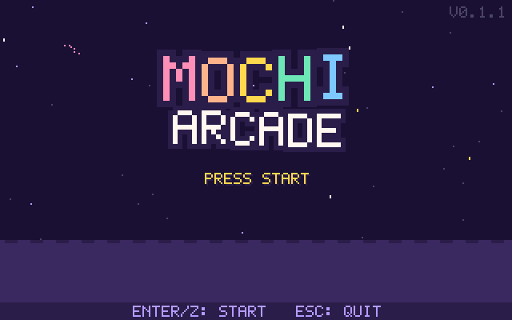
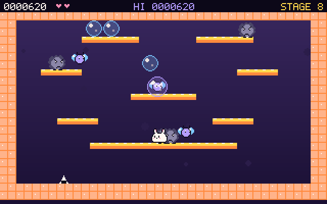
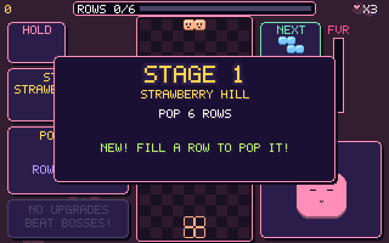
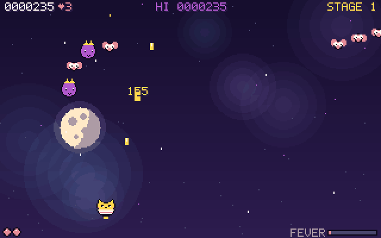
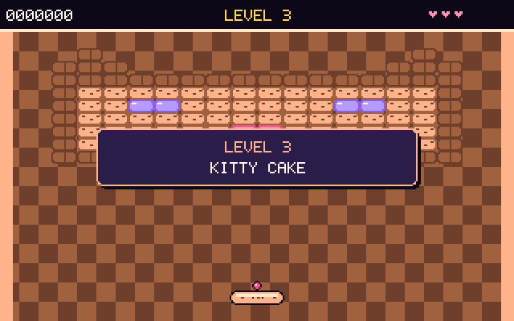
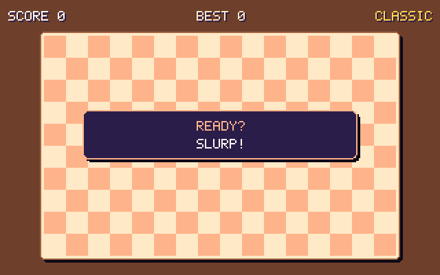

# MOCHI ARCADE

**A cute retro arcade starring the mochi gang** — five original mini games with pixel art, chiptune music and save profiles. Runs on Linux desktops, macOS, and even straight on a Linux text console (no X / Wayland needed), so an old laptop turned home server can be a tiny arcade machine.

```sh
curl -fsSL https://raw.githubusercontent.com/neuralfoundry-coder/mochi-arcade/main/install.sh | sh   # install
mochi-arcade                                                                                         # play
```

<p align="center"></p>

## The games

Every game is a **200-stage campaign**: a new theme every 10 stages, a **boss on every 10th stage**, a **bonus stage on every x5**, upgrade cards to build your run, checkpoints (1, 11, 21 …) to continue from, and the arcade hype — combos, **FEVER** (score x2), surprise **JACKPOT** moments and extra lives.

| | |
|---|---|
| <br>**Soap Hop** — single-screen platformer. Momo the mochi bunny traps dust grumps in soap bubbles and pops them into snacks. 6 bosses (King Fluff, Mop Titan, Whirl Cloud …), bubble-party bonus rounds, M-O-C-H-I letter bubbles, chain pops up to MEGA SUDS. | <br>**Jelly Stack** — falling-block puzzle with stage goals (pop rows, dig, star jellies, survive, puzzles). Jelly bosses attack your well with telegraphed garbage, ice and ink; JELLY PARTY, JELLY TWIST, golden pieces. Marathon / Sprint 40 / Endless stay as extra modes. |
| <br>**Comet Kitty** — fixed-screen shooter. Tama the teacup kitty versus 8 kinds of space critters flying 12 entry patterns, 6 big bosses with telegraphed lasers and weak spots, bonus parades with medal chains, 10 upgrades (spread, homing, lance, star pals …), auto-fire option. | <br>**Bounce Bun** — brick breaker. 31 snack pictures + generated layouts with gumdrop bombs, keys and locks, portals and bumpers; 5 bosses (Cake Castle, Jelly Donut, Cookie Jar, Ginger-Bot, Candy Whale), coin-bake bonus stages, fireball FEVER. |
| <br>**Noodle Slurp** — snake. Goal stages in 20 kitchens with portals, meatballs, doors, ice, steam vents, conveyors and closing walls; 6 bosses (trap the Fortune Spook in a noodle loop!), dumpling feasts, golden rushes. Classic and wrap-around endless modes too. | <br>**CAT CORNER — coming next:** eleven new cat-hero games are being built — a maze raid, a cat-tree climb, alley crossing, yarn weaving, cloud jumping, a kitten-matching puzzle, an arena shooter, a rooftop runner, a fishbowl defense, pinball and **MEOW DECK**, a card battler with dozens of different cats. |

<sub>Clips were recorded on **Ubuntu 24.04 on a 2015 MacBook Pro**, straight from the game's frame buffer (`packaging/record_gifs.py`, played by simple autoplay bots).</sub>

**Arcade front end:** title → choose / create a **profile** → main menu → pick a game → game options (difficulty, start stage, mode …) → play. Each profile keeps its own settings, high-score tables and last-used options.

## Install & play

```sh
curl -fsSL https://raw.githubusercontent.com/neuralfoundry-coder/mochi-arcade/main/install.sh | sh
mochi-arcade
```

That's it — the first line installs, the second starts the arcade.

| Command | |
|---|---|
| `mochi-arcade` | start (full screen) |
| `mochi-arcade --windowed` | start in a window (desktop) |
| `mochi-arcade --mute` | no sound |
| `sudo mochi-arcade --setup-input` | one-time fix for a text console where the game plays music but ignores keys (the `.deb` already does this) |
| `mochi-arcade --version` | show the version |

What the installer does:

- **Debian / Ubuntu** — installs the `.deb` from the latest release with `apt`, which pulls in `python3-pygame`.
- **Other Linux and macOS** — installs into `~/.local/share/mochi-arcade` with its own Python venv (needs `python3`) and puts the `mochi-arcade` command in `~/.local/bin`.

Or grab the packages from the [releases page](https://github.com/neuralfoundry-coder/mochi-arcade/releases):

```sh
sudo apt install ./mochi-arcade_0.2.0_all.deb && mochi-arcade      # Debian / Ubuntu
pip install mochi-arcade-0.2.0.tar.gz && mochi-arcade              # anywhere with Python 3.8+
```

From source: `pip install pygame && python3 -m mochi_arcade`.

### Playing on a Linux text console

On a machine without a desktop, MOCHI ARCADE draws directly to the screen through KMS/DRM. Start it with `mochi-arcade` from the local console (not over SSH). There the keyboard is read straight from `/dev/input`. The Debian package installs a small udev rule (`70-mochi-arcade-input.rules`) that gives the user at the active console access to keyboards, the same way logind already does for gamepads. With other install methods, run `sudo mochi-arcade --setup-input` once. The package also recommends `libegl1` and `libgl1-mesa-dri`, which are needed for this. If there is no sound, unmute the speakers with `alsamixer`.

### iPhone & iPad

A native Swift port lives in [`ios/`](ios/) — the same games, stages, art and music. The game fills the screen and the
touch controls float on top: a **floating thumb pad** on the left (put your thumb down anywhere and slide — it
centres itself under your thumb) and **per-game buttons** placed around the resting right thumb. iPhone plays in
landscape; hardware keyboards and game controllers work too. **Options → SCREEN** switches FULL / STRETCH / PIXEL.
It is distributed through TestFlight.

## Controls

| | Keyboard | Gamepad |
|---|---|---|
| Move | arrow keys / WASD | d-pad / stick |
| OK · jump · fire | Z / Space | A |
| Back · bubble · rotate | X / Ctrl | B |
| Hold (Jelly Stack) | C / Shift | X |
| Pause | Enter / P / Esc | Start |
| Fullscreen · screenshot | F11 · F12 | |

Jelly Stack: ↑ / X rotate right, Z rotate left, ↓ soft drop, Space hard drop, C hold.

Profiles and screenshots are saved in `~/.local/share/mochi-arcade/`, generated music in `~/.cache/mochi-arcade/`.

## Originality & licenses

Everything here — game designs, names, characters, pixel art, the pixel font, music and sound effects — was made for this project. All art is drawn from code and all sound is synthesized at run time. The games belong to classic genres, whose mechanics are free to use, but they do not copy any existing game's name, characters, graphics, music or levels. See [NOTICE.md](NOTICE.md).

- Code and assets: **MIT** ([LICENSE](LICENSE))
- Dependencies (not bundled): pygame (LGPL-2.1), SDL 2 (zlib), Python (PSF)

## Support

If MOCHI ARCADE made you smile, you can [sponsor the project](https://github.com/sponsors/neuralfoundry-coder) 💖

---

## 한국어 소개

**모찌 친구들이 나오는 귀여운 레트로 아케이드**입니다. 오리지널 미니게임 5종, 도트 그래픽, 칩튠 음악, 프로필 저장을 지원합니다. 리눅스 데스크톱과 macOS는 물론, X 서버가 없는 **리눅스 콘솔에서도 화면에 바로** 실행됩니다.

모든 게임이 **200스테이지 캠페인**입니다. 10스테이지마다 테마가 바뀌고 **보스**가 나오며, x5 스테이지는 **보너스 스테이지**, 보스를 잡으면 **업그레이드 카드**를 고릅니다. 콤보, **FEVER**(점수 2배), 깜짝 **JACKPOT**, 체크포인트(1, 11, 21 …) 이어하기를 지원합니다.

| 게임 | 장르 | 내용 |
|---|---|---|
| **Soap Hop** | 플랫포머 | 모찌 토끼 모모가 비눗방울로 먼지 그럼프를 가둬 터뜨림. 보스 6종, 버블 파티 보너스, M-O-C-H-I 글자 |
| **Jelly Stack** | 낙하 블록 퍼즐 | 스테이지 목표(줄 지우기·파내기·별 젤리·퍼즐), 젤리 보스의 방해 공격, JELLY PARTY / TWIST |
| **Comet Kitty** | 슈팅 | 찻잔 고양이 타마 vs 우주 생물 8종, 보스 6종(레이저 예고·약점), 메달 체인 퍼레이드, 업그레이드 10종 |
| **Noodle Slurp** | 스네이크 | 20개 주방 테마, 포털·미트볼·문·얼음·증기·컨베이어, 보스 6종, 만두 잔치 보너스 |
| **Bounce Bun** | 벽돌깨기 | 과자 그림 31종 + 생성 레이아웃, 폭탄·열쇠·포털·범퍼, 보스 5종, 불꽃 FEVER |
| **CAT CORNER** | (제작 중) | 고양이 주인공 신작 10종 + 다양한 고양이 카드 배틀 **MEOW DECK** |

```sh
curl -fsSL https://raw.githubusercontent.com/neuralfoundry-coder/mochi-arcade/main/install.sh | sh   # 설치
mochi-arcade                                                                                         # 실행
```

- 창 모드: `mochi-arcade --windowed`, 소리 끄기: `mochi-arcade --mute`
- 리눅스 콘솔(데스크톱 없음)에서 음악만 나오고 키가 안 먹으면 한 번만: `sudo mochi-arcade --setup-input` (`.deb` 설치 시에는 자동 적용)

위의 플레이 영상은 맥북프로 2015의 우분투 24.04에서 게임을 실행해 녹화한 것입니다.

**iPhone·iPad 버전**은 Swift로 다시 만든 네이티브 앱으로 `ios/` 폴더에 있습니다(터치 패드, 키보드·게임패드 지원, 가로·세로 레이아웃). 게임 화면이 전체 화면을 채우고 버튼은 그 위에 반투명하게 떠 있습니다. **OPTIONS → SCREEN**에서 FULL(비율 유지 최대), STRETCH(화면 꽉 채움), PIXEL(정수배 선명한 픽셀)을 고를 수 있습니다. TestFlight로 배포합니다.

모든 게임 디자인·이름·캐릭터·그래픽·음악은 이 프로젝트를 위해 새로 만든 것이며 MIT 라이선스입니다.
