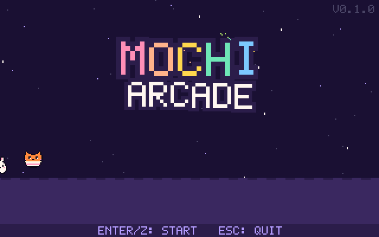
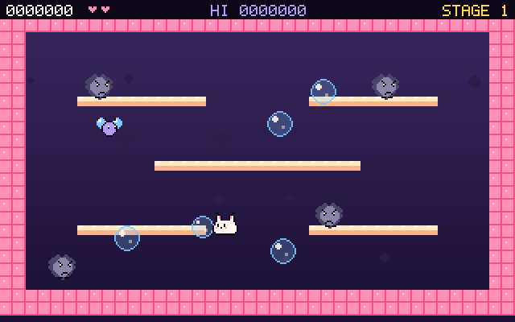
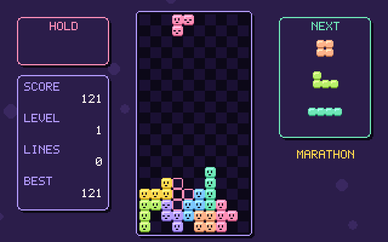
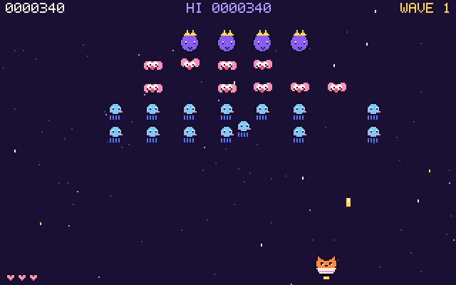
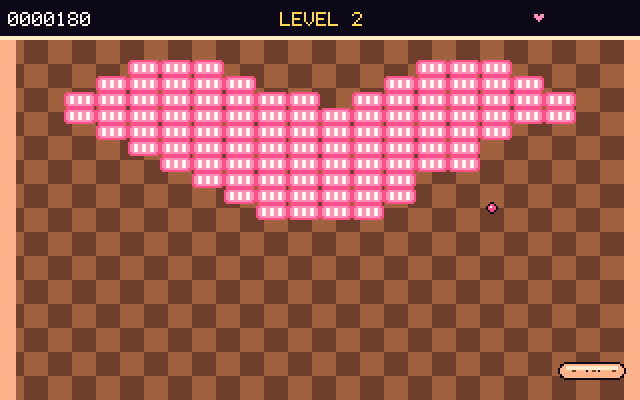
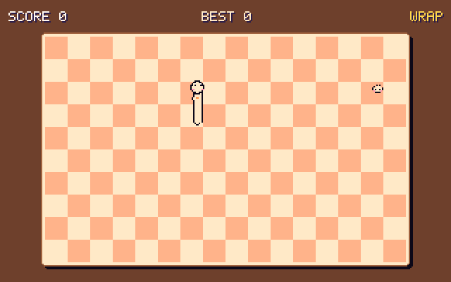
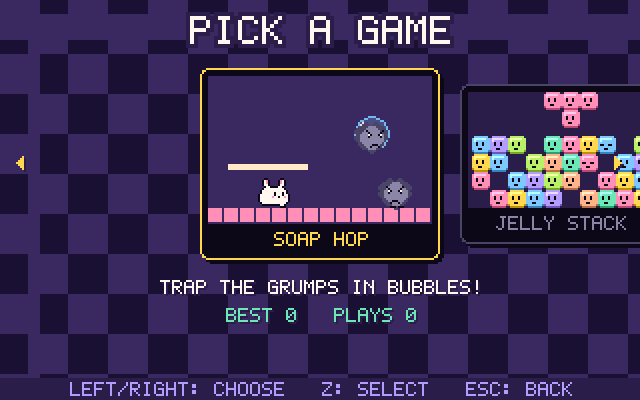

# MOCHI ARCADE

**A cute retro arcade starring the mochi gang** — five original mini games with pixel art, chiptune music and save profiles. Runs on Linux desktops, macOS, and even straight on a Linux text console (no X / Wayland needed), so an old laptop turned home server can be a tiny arcade machine.



| | |
|---|---|
|  |  |
|  |  |
|  |  |

## The games

| Game | Genre | |
|---|---|---|
| **Soap Hop** | single-screen platformer | Momo the mochi bunny blows soap bubbles to trap dust grumps, then pops them into snacks. Chain pops for big bonuses, bounce on bubbles, 8 stages. |
| **Jelly Stack** | falling-block puzzle | Stack wobbly jelly cubes and clear rows. Hold, 3-piece preview, ghost piece, wall kicks, lock delay. Marathon, Sprint 40 and Endless modes. |
| **Comet Kitty** | fixed-screen shooter | Tama the teacup kitty versus space jellies that glide into formation and swoop down. Boss puffs drop friend stars (wingman!), bonus parade every 4th wave. |
| **Noodle Slurp** | snake | A hungry noodle slurps dumplings; golden ones are worth a lot. Classic, wrap-around and maze modes. |
| **Bounce Bun** | brick breaker | Bounce a gumball off a bun into cookies, candy and chocolate. Wide / multi-ball / slow / glue / extra-life capsules, 8 levels. |

**Arcade front end:** title → choose / create a **profile** → main menu → pick a game → game options (difficulty, start stage, mode …) → play. Each profile keeps its own settings, high-score tables and last-used options.

## Install

```sh
curl -fsSL https://raw.githubusercontent.com/neuralfoundry-coder/mochi-arcade/main/install.sh | sh
```

- **Debian / Ubuntu** — installs the `.deb` from the latest release with `apt`, which pulls in `python3-pygame`.
- **Other Linux and macOS** — installs into `~/.local/share/mochi-arcade` with its own Python venv (needs `python3`).

Or grab the packages from the [releases page](https://github.com/neuralfoundry-coder/mochi-arcade/releases):

```sh
sudo apt install ./mochi-arcade_0.1.0_all.deb          # Debian / Ubuntu
pip install mochi-arcade-0.1.0.tar.gz                  # anywhere with Python 3.8+
```

From source: `pip install pygame && python3 -m mochi_arcade`.

Then run **`mochi-arcade`** (`--windowed`, `--mute` are available).

### Playing on a Linux text console

On a machine without a desktop, MOCHI ARCADE draws directly to the screen through KMS/DRM. Start it from the local console (not over SSH). The Debian package recommends `libegl1` and `libgl1-mesa-dri`, which are needed for this. If there is no sound, unmute the speakers with `alsamixer`.

## Controls

| | Keyboard | Gamepad |
|---|---|---|
| Move | arrow keys / WASD | d-pad / stick |
| OK · jump · fire | Z / Space | A |
| Back · bubble · rotate | X / Ctrl | B |
| Hold (Jelly Stack) | C / Shift | X |
| Pause | Enter / P / Esc | Start |
| Fullscreen · screenshot | F11 · F12 | |

Jelly Stack: ↑ / X rotate right, Z rotate left, ↓ soft drop, Space hard drop, C hold.

Profiles and screenshots are saved in `~/.local/share/mochi-arcade/`, generated music in `~/.cache/mochi-arcade/`.

## Originality & licenses

Everything here — game designs, names, characters, pixel art, the pixel font, music and sound effects — was made for this project. All art is drawn from code and all sound is synthesized at run time. The games belong to classic genres, whose mechanics are free to use, but they do not copy any existing game's name, characters, graphics, music or levels. See [NOTICE.md](NOTICE.md).

- Code and assets: **MIT** ([LICENSE](LICENSE))
- Dependencies (not bundled): pygame (LGPL-2.1), SDL 2 (zlib), Python (PSF)

## Support

If MOCHI ARCADE made you smile, you can [sponsor the project](https://github.com/sponsors/neuralfoundry-coder) 💖

---

## 한국어 소개

**모찌 친구들이 나오는 귀여운 레트로 아케이드**입니다. 오리지널 미니게임 5종, 도트 그래픽, 칩튠 음악, 프로필 저장을 지원합니다. 리눅스 데스크톱과 macOS는 물론, X 서버가 없는 **리눅스 콘솔에서도 화면에 바로** 실행됩니다.

| 게임 | 장르 | 내용 |
|---|---|---|
| **Soap Hop** | 플랫포머 | 모찌 토끼 모모가 비눗방울로 먼지 그럼프를 가둬 터뜨림 |
| **Jelly Stack** | 낙하 블록 퍼즐 | 말랑한 젤리 블록 쌓기 (홀드, 넥스트, 고스트, 마라톤·스프린트·엔드리스) |
| **Comet Kitty** | 슈팅 | 찻잔 고양이 타마 vs 우주 해파리 편대, 윙맨 별, 보너스 퍼레이드 |
| **Noodle Slurp** | 스네이크 | 만두 먹는 국수, 금만두, 클래식·랩·미로 모드 |
| **Bounce Bun** | 벽돌깨기 | 빵 패들로 과자 벽돌 깨기, 파워업 캡슐 |

```sh
curl -fsSL https://raw.githubusercontent.com/neuralfoundry-coder/mochi-arcade/main/install.sh | sh
mochi-arcade
```

모든 게임 디자인·이름·캐릭터·그래픽·음악은 이 프로젝트를 위해 새로 만든 것이며 MIT 라이선스입니다.
